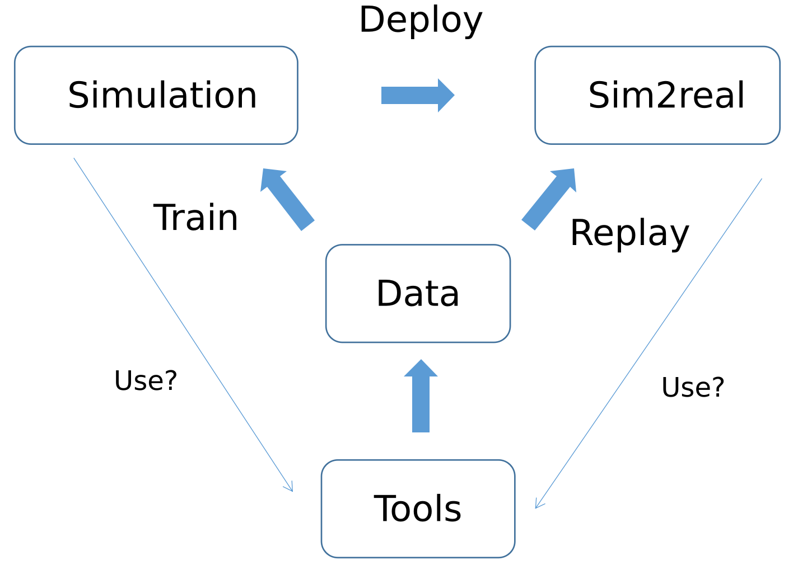

# HumanoidVerse3: 多仿真器人形机器人仿真到真实学习框架

[](https://docs.omniverse.nvidia.com/isaacsim/latest/overview.html)
[](https://isaac-sim.github.io/IsaacLab/)
[](https://github.com/Genesis-Embodied-AI/Genesis)
[]()

<p align="center">
  
</p>

## 概述

HumanoidVerse3是一个高度集成的人形机器人仿真到真实部署框架，支持多种主流仿真环境和机器人平台。该框架采用模块化架构设计，提供统一的API接口，支持在不同仿真器之间无缝切换，并提供从强化学习训练到实际硬件部署的完整工作流程。

[中文文档](README_V3_zh.md) | [快速开始](#快速开始) | [详细文档](README_V2.md)

## 核心特性

### 多仿真器支持
该框架集成了当前主流的机器人仿真环境，提供统一的接口层：
- **Isaac Gym** - NVIDIA高性能GPU并行仿真环境，支持大规模强化学习训练
- **Isaac Sim** - 基于Omniverse平台的高保真仿真环境，支持PhotoRealistic渲染
- **Genesis** - 现代化物理引擎仿真器，提供高精度物理模拟
- **MuJoCo** - 灵活的刚体动力学仿真系统，适用于机器人控制研究


### 任务环境
提供多种预定义的任务环境和运动技能：
- **运动跟踪** - 基于视频数据的人体运动捕捉与机器人运动重现
- **自定义任务** - 基于模块化架构的任务扩展能力

### Sim2Real部署
完整的仿真到真实部署管道：
- **硬件接口** - 支持实际机器人硬件的完整控制接口
- **sim2sim验证** - 使用mujoco进行验证
- **模型优化** - 基于ONNX的推理优化，支持实时控制

## 系统要求

| 组件 | 版本要求 | 用途 |
|------|---------|------|
| Python | ≥3.8 | 核心运行时环境 |
| PyTorch | ≥1.12 | 深度学习框架 |
| CUDA | ≥11.0 | GPU加速计算 |
| Isaac Gym | Preview 4 | NVIDIA GPU仿真 |
| Isaac Sim | 4.5.0 | Omniverse仿真平台 |
| Genesis | 0.2.1 | 现代物理仿真引擎 |

## 安装指南

### 1. 环境准备

```bash
# 克隆项目
git clone https://github.com/nathanwu7/HumanoidVerse3.git
cd HumanoidVerse3

# 为每个仿真器创建独立的conda环境
conda create -n hgym python=3.8    # IsaacGym环境
conda create -n hsim python=3.10   # IsaacSim环境
conda create -n hgen python=3.10   # Genesis环境
```

### 2. 安装Isaac Gym

```bash
conda activate hgym

# 下载Isaac Gym
cd ../
wget https://developer.nvidia.com/isaac-gym-preview-4
tar -xvzf isaac-gym-preview-4

# 安装Python API
pip install -e ./isaacgym/python/

# 配置环境变量以处理共享库问题ImportError: libpython3.8.so.1.0: cannot open shared object file: No such file or directory

# 激活环境时自动设置LD_LIBRARY_PATH
cd $CONDA_PREFIX
mkdir -p ./etc/conda/activate.d
cat > ./etc/conda/activate.d/env_vars.sh << 'EOF'
export OLD_LD_LIBRARY_PATH=${LD_LIBRARY_PATH}
export LD_LIBRARY_PATH=$LD_LIBRARY_PATH:$CONDA_PREFIX/lib
EOF

# 退出环境时恢复LD_LIBRARY_PATH
mkdir -p ./etc/conda/deactivate.d
cat > ./etc/conda/deactivate.d/env_vars.sh << 'EOF'
export LD_LIBRARY_PATH=${OLD_LD_LIBRARY_PATH}
unset OLD_LD_LIBRARY_PATH
EOF

# 安装HumanoidVerse3
cd HumanoidVerse3
pip install -e .
pip install -e humanoidverse/isaac_utils
# 重要：重新激活环境以使环境变量生效
conda deactivate
conda activate hgym
```

### 3. 安装Isaac Sim

```bash
conda activate hsim

# 按照官方文档安装Isaac Sim和Isaac Lab
# https://isaac-sim.github.io/IsaacLab/main/source/setup/installation/binaries_installation.html

# 安装HumanoidVerse3
pip install -e .
pip install -e humanoidverse/isaac_utils
### 4. 安装Genesis

```bash
conda activate hgen

# 安装Genesis
pip install torch
pip install genesis-world==0.2.1

# 安装HumanoidVerse3
pip install -e .
pip install -e humanoidverse/isaac_utils

## 快速开始

### 训练示例

```bash
# 确保在Isaac Gym环境中
conda activate hgym

# Isaac Gym环境训练运动跟踪任务
python humanoidverse/train_agent.py +simulator=isaacgym +exp=motion_tracking
```

### 评估示例

```bash
# 加载训练好的模型进行评估
python humanoidverse/eval_agent.py \
  +checkpoint=logs/MotionTracking/xxx.pt \
  headless=False
```

### Sim2Real部署

```bash
# 启动MuJoCo仿真验证
python -m humanoid_sim2real.sim2sim.deploy_mujoco_sim_kungfu
```

## 项目结构

```
HumanoidVerse3/
├── humanoidverse/              # 核心框架代码
│   ├── agents/                 # 强化学习算法
│   │   ├── ppo/               # PPO算法实现
│   │   └── mh_ppo/            # 多头PPO算法
│   ├── envs/                  # 环境定义
│   │   ├── motion_tracking/   # 运动跟踪任务
│   │   └── legged_base_task/  # 基础腿部控制任务
│   ├── simulator/             # 仿真器接口
│   │   ├── isaacgym/         # IsaacGym接口
│   │   ├── isaacsim/         # IsaacSim接口
│   │   └── genesis/          # Genesis接口
│   └── utils/                # 工具函数
├── humanoid_sim2real/         # Sim2Real部署工具
│   ├── ckpt_demo/            # 预训练模型
│   ├── configs/              # 部署配置
│   └── motion_lib/           # 运动库
├── data/                     # 数据资源
│   ├── motions/              # 运动数据
│   │   ├── PBHC/            # 武术动作数据
│   │   └── GVHMR/           # 通用运动数据
│   └── robots/               # 机器人模型
│       ├── g1/               # G1机器人模型
│       └── h1/               # H1机器人模型
└── configs/                  # Hydra配置文件
    ├── robot/                # 机器人配置
    ├── simulator/            # 仿真器配置
    └── exp/                  # 实验配置
```

## 运动数据

本框架集成了多种人体运动数据集，支持复杂动态动作的学习与重现：

### 武术动作数据集 (PBHC)
框架内置基于Physics-Based Humanoid Control (PBHC) 的武术动作数据：
- **马步冲拳** - 传统武术基础动作，包含身体平衡与力量控制
- **侧踢** - 高难度单腿平衡踢击动作
- **后旋踢** - 涉及复杂旋转运动的连续动作
- **钩拳** - 快速连续打击动作序列

### 舞蹈动作数据
提供多种舞蹈动作的运动捕捉数据：
- **Charleston舞** - 经典摆摆舞动作序列
- **Bruce Lee动作** - 标志性功夫动作姿态

### 运动数据处理工具链（MotionHub）
完整的运动数据处理管道：
- 视频运动捕捉和关键点提取
- 人体运动到机器人关节空间的自动映射
- 基于PBHC算法框架的运动优化和平滑处理

## 技术特色

### 模块化架构设计
- **BaseManager** - 提供统一的组件生命周期管理
- **BaseComponent** - 支持算法组件的模块化开发
- **Hydra配置系统** - 实现灵活的超参数管理和实验配置

### 多仿真器一致性
- 统一的抽象API接口，屏蔽底层仿真器差异
- 自动化的参数转换和适配机制
- 支持跨仿真器的模型迁移和验证

### 高级运动控制算法
- 基于物理约束的全身控制策略
- 支持复杂动态技能的强化学习
- 实时优化算法确保控制的稳定性和精确性

## 文档和资源

详细的使用说明请参考：

- [训练指南](README_V2.md) - 完整的训练流程
- [Sim2Real部署](humanoid_sim2real/README_sim2sim_setup.md) - 部署指南
- [配置说明](humanoidverse/config/) - 参数配置详解

## 相关工作

本项目基于以下优秀工作：

```bibtex
@misc{HumanoidVerse2,
  author = {Zeng Liangjun},
  title = {HumanoidVerse2: A Multi-Simulator Framework with Modular Design for Humanoid Robot Sim-to-Real Learning},
  year = {2025},
  publisher = {GitHub},
  howpublished = {\url{https://github.com/zengliangjun/HumanoidVerse2}},
}

@misc{HumanoidVerse,
  author = {CMU LeCAR Lab},
  title = {HumanoidVerse: A Multi-Simulator Framework for Humanoid Robot Sim-to-Real Learning},
  year = {2025},
  publisher = {GitHub},
  howpublished = {\url{https://github.com/LeCAR-Lab/HumanoidVerse}},
}

@article{xie2025kungfubot,
  title={KungfuBot: Physics-Based Humanoid Whole-Body Control for Learning Highly-Dynamic Skills},
  author={Xie, Weiji and Han, Jinrui and Zheng, Jiakun and Li, Huanyu and Liu, Xinzhe and Shi, Jiyuan and Zhang, Weinan and Bai, Chenjia and Li, Xuelong},
  journal={arXiv preprint arXiv:2506.12851},
  year={2025}
}
```


## 许可证

本项目基于 MIT 许可证开源。详细信息请查看 [LICENSE](LICENSE) 文件。

## 联系方式

- 项目维护者: Qiwei Wu, Yixiao Feng, Xiangrui Jiang
- 邮箱: nathan.wuqw@gmail.com

---


